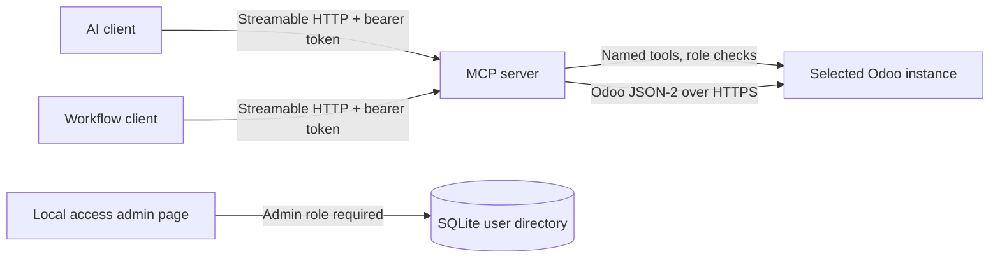

# Odoo Projects MCP

An independently deployable MCP server that gives AI clients and workflow tools a narrow, role-controlled interface to Odoo projects, tasks, Discuss channels, CRM opportunities, support tickets, purchase orders, vendor bills, website pages, and blog posts.

> **Portfolio project:** demonstrates integration planning, API discovery, scoped tool design, role-based access, Docker deployment, and security trade-off documentation. It is a prototype and has not been independently audited or certified for regulatory compliance.

## The problem

Business teams want to use AI assistants and automation with the project and website data already held in Odoo. Giving an AI client generic database or model access would be too broad. This service exposes named operations with explicit inputs and field allowlists, while Odoo's own permissions remain in force.

## Architecture



The operator selects a configured Odoo instance on each tool call. The server does not expose arbitrary SQL or a generic model-call tool. Odoo API credentials stay on the server.

Business tools accept an optional exact `company` name. The server lists companies available to the configured Odoo user through `list_companies`, selects the sole available company automatically, and requires an explicit choice when the user can access more than one. It scopes calls through Odoo's `allowed_company_ids` context. Company-independent shared records may still be visible according to Odoo's own rules.

## Current capabilities

- Search and read projects and tasks.
- Search and read Helpdesk tickets; update ticket subject, description, priority, team, stage, and assignee with a dedicated role.
- Search Discuss channels and read their messages for a requested date range.
- Search and read CRM opportunities; create, edit, stage, archive, and restore opportunities with the `crm_editor` role. Editable fields include contact details, revenue, probability, priority, tags, owner, team, source, campaign, deadline, and description.
- Search and read RFQs and purchase orders; create draft RFQs, edit their header and lines, and confirm them with separate roles. Create draft vendor bills from confirmed orders when Odoo reports invoiceable quantities; posting bills remains an Odoo-side action.
- Create and update projects and tasks with validated fields, including task assignees; move tasks between project stages and allowed states; archive and restore tasks and projects.
- Search and read website pages, update page content, and publish or unpublish with separate tools.
- List websites and blogs; search, read, create, and edit blog posts with explicit website targeting. `create_blog_post` and `update_blog_post` write in the Odoo connection user's language, which must be the website's primary language. To translate a post, create it in the primary language, call `get_blog_post_translation_terms`, then send the returned term map as `content_terms` to `set_blog_post_translation`; this updates HTML terms without replacing the primary content. Editors can attach public cover images; schedulers can set a future publication time. Blog creation always starts unpublished, and publish/unpublish use separate tools and roles.
- `create_blog_post` and `update_blog_post` accept `content_format`: `html` (default, content stored as given) or `marked_text`. `set_blog_post_translation` accepts `content_marked_text` as an alternative to `content_terms`. See [Marked text format](#marked-text-format).
- `update_blog` renames a blog or changes its subtitle in one active website language (`lang` is required). Renaming changes the blog's URL slug.
- `get_blog_post` returns `cover_image_url`, the absolute URL of the post's cover image (or `null`), so a client can reuse it as `website_meta_og_img`.
- `create_blog_post` and `update_blog_post` accept an optional `lang` (Odoo code such as `en_US`). It must be the website's primary language, otherwise the call fails without writing; the post is then written in that language whatever the Odoo user's language is. Clients use it to check that their original text is in the language Odoo expects before adding translations.
- Until its scheduled date, Odoo hides a post only from the blog list; its URL, `/feed`, and `/sitemap.xml` already show it.
- Scheduling also sends Odoo's new-post notification to blog followers immediately.
- Authenticate MCP users with bearer tokens and grant permissions through named roles.
- Manage Odoo connections, users, roles, token rotation, and revocation in a local admin page.
- List Odoo companies available to the technical user and apply an explicit company context to business tools.
- Connect to Odoo 19+ through JSON-2 or Odoo 15/18 through XML-RPC over HTTPS.

Support-ticket tools target the `helpdesk.ticket` model and require a Helpdesk module that provides that model on the Odoo database, plus appropriate Odoo access rights for the technical user. Helpdesk is not part of every Odoo Community installation; availability depends on the installed edition/modules.

Purchase tools use Odoo's standard `purchase.order` and `purchase.order.line` models. They are implemented for the configured XML-RPC path (Odoo 15/18) and JSON-2 path (Odoo 19), but still need live verification on each supported deployment. The bill operation calls Odoo's purchase invoicing action and returns the resulting draft supplier bill (`account.move` with `move_type=in_invoice`); it does not post the bill.


## Marked text format

The content generator saves long-form posts to a Google Doc as marked text, which a person reviews before a client publishes it through this server. The conversion to HTML is a fixed rule implemented once, in `odoo_mcp/marked_text.py`:

| Marked text | HTML |
|---|---|
| `H1: Title` (at most one) | Post `name` when `name` is not passed; if `name` is passed, it wins and the H1 line is dropped |
| `H2: ` … `H6: ` | `<h2>` … `<h6>` |
| Lines starting with `• `, `- ` or `* ` | `<ul><li>` (blank lines between items keep one list) |
| Lines starting with `1. `, `2. ` … | `<ol><li>` |
| Other lines | `<p>` per block separated by blank lines; single line breaks become spaces |
| Bare `http://` or `https://` URLs | `<a href="…">…</a>` |

Before converting, trailing spaces, repeated blank lines, and the Google Docs escapes `\_ \# \* \[ \]` are cleaned, and `&`, `<` and `>` are escaped. The output has no classes or styles, and no content is added or removed: hashtags, calls to action, and similar decisions belong to the generator or the reviewer.

For a translation, pass the translated marked text with the same structure as the primary-language text as `content_marked_text`. Its blocks are paired by position with the post's Odoo translation terms. Odoo translates each link separately from the text before and after it (bold and italics stay inside the term), so each block must also keep the same links. A marked-text link's text is its URL, so a source link with descriptive text, such as «CEPAL press release», is translated with the URL; use `content_terms` to translate such link texts. If the number or type of blocks or links differs, or the post contains terms outside its text blocks, the call fails without writing anything; use `content_terms` for such posts. A translated H1 line becomes that language's `name` unless `name` is passed.

## Security model and current limits

- MCP roles restrict tool access and each user can be restricted to named Odoo instances; Odoo permissions and record rules provide a second authorization layer.
- The Odoo instance name is selected explicitly, and the configured URL must use HTTPS.
- The default Compose binding is `127.0.0.1`; this is a local development setup, not a public deployment recipe.
- Existing SQLite users keep all-instance access during schema migration to preserve current behavior. A `*` scope also grants access to instances added later; review and narrow user scopes as needed.
- The admin page can add, edit, test, deactivate, and reactivate Odoo targets. API keys are kept in `mcp-state/odoo-instances.json` outside the source tree with restrictive file permissions; they are not encrypted by the application.
- Tokens are static bearer tokens. There is no OAuth/OIDC flow, rate limiting, or production audit trail yet.
- The same configured Odoo technical account is used for calls to a target, so Odoo does not attribute each MCP action to a distinct human user.
- The admin page is intended for local use. Remote use requires a deliberate identity, HTTPS, session, and deployment security design.
- No GDPR, AI Act, NIS2, or other compliance certification or conclusion is claimed. Applicability and controls depend on the deployment, data, purpose, and parties involved.

See [Architecture](docs/ARCHITECTURE.md), [Threat model](docs/THREAT_MODEL.md), and [Data protection notes](docs/DATA_PROTECTION.md) for assumptions and open work.

## Run locally

Requirements: Docker Compose and an Odoo instance with an enabled external API.

1. Set up Compose configuration and a private connection directory. For the local default:

   ```sh
   cp compose.env.example .env
   mkdir -p local
   cp .env.example local/.env
   cp odoo-instances.example.json local/odoo-instances.json
   cp mcp-users.example.json local/mcp-users.json
   ```

2. Set an Odoo API key and unique random MCP tokens of at least 32 characters in `local/.env`. Set the initial URL and API-key environment variable name in `local/odoo-instances.json`. In `local/mcp-users.json`, grant each user only the configured instance names they need; `*` means all current and future instances.
3. Start the service:

   ```sh
   docker compose up -d --build
   ```

The MCP endpoint is `http://127.0.0.1:8000/mcp`; the local admin page is `http://127.0.0.1:8001/admin`. The admin page has its own port (`MCP_ADMIN_PORT`), which Compose always publishes on `127.0.0.1` only. Setting `MCP_BIND=0.0.0.0` publishes `/mcp` to the local network over plain HTTP, so bearer tokens are not encrypted; do this only on a trusted network that is not reachable from the internet. The configured `owner` token is used to sign in. User tokens are shown once when created or rotated. Add later Odoo targets from the **Odoo instances** section; a successful authenticated read is required before creating or editing a connection, and the server repeats the check so a direct API request cannot bypass it. Removing a key is allowed only after deactivating that instance; an instance without a key cannot be reactivated. Local config, instance credentials, SQLite state, and `.env` files are outside Git and the Docker build context.

Choose **JSON-2** for Odoo 19+ or **XML-RPC** for Odoo 15/18 connections in the admin page. XML-RPC needs the database name, Odoo username/login, and an API key (used as the API password); JSON-2 uses an API key and an optional database name. External API availability can depend on the Odoo hosting plan. Odoo 19 introduced JSON-2; Odoo 15 and 18 use the XML-RPC integration path here.

When upgrading an existing SQLite user database, the schema adds the instance allowlist while preserving existing access as `*`. After starting the upgraded service, use the admin page to replace `*` with explicit instance names for each account before configuring additional Odoo targets.

To keep configuration outside the repository, set `MCP_CONNECTIONS_DIR` in the ignored project-root `.env` to the private configuration directory. Keep the API key and initial user tokens in that private directory's `.env`. On first startup, the service copies the bootstrap instance settings into `mcp-state/odoo-instances.json`; later API key changes are made in the admin page. Restrict access to this directory and back it up securely. The Compose file defaults to `./local` for a fresh clone.

## Roles

| Role | Tools |
| --- | --- |
| `viewer` | Connection check and project, task, support ticket, and page search/read; archived records can be included in searches |
| `task_editor` | Create and update tasks; list project stages and change task stage/state |
| `task_archiver` | Archive and restore tasks |
| `support_ticket_editor` | Update ticket subject, description, priority, team, stage, and assignee; `clear_assignee` removes the assignee |
| `crm_editor` | Create and edit CRM opportunities, change stage, archive, and restore them |
| `project_manager` | Search, read, create, update, archive, and restore projects; list task stages |
| `website_editor` | Edit page content |
| `publisher` | Publish and unpublish pages |
| `blog_editor` | List websites and blogs; rename blogs per language; search, read, create, edit, and translate blog posts |
| `blog_publisher` | List websites and blogs; search, read, publish, and unpublish blog posts |
| `blog_scheduler` | Schedule blog posts for a future date |
| `purchase_viewer` | Search and read RFQs, purchase orders, and their lines |
| `purchase_manager` | Create draft RFQs and edit draft/sent RFQ headers and lines |
| `purchase_approver` | Confirm draft/sent RFQs into purchase orders |
| `vendor_bill_creator` | Create draft supplier bills from confirmed orders with invoiceable quantities |
| `administrator` | All currently registered tools and user administration |

Roles can be combined for a user. `viewer` can find Discuss channels and read channel messages for an inclusive date range, and can search/read CRM opportunities, including archived ones when requested. `crm_editor` adds create, field edit, stage-change, archive, and restore operations. Viewer can also search and read support tickets, including each ticket's `message_count` and its conversation (`get_support_ticket_messages`: emails, messages and internal notes, oldest first); `search_support_tickets` pages with `offset` and can omit the long description with `include_description=false`. Combine it with `support_ticket_editor` when the user needs both read and update access. Instance access is configured separately per user. New users in the admin page must receive explicit active instance names; use `*` only when they need every current and future instance.

Archiving a project also archives all its tasks. Restoring the project restores all its tasks too, including tasks that were already archived individually before the project was archived.

## Development

Run the unit suite in Docker:

```sh
docker build -f Dockerfile.test -t odoo-projects-mcp-test .
docker run --rm odoo-projects-mcp-test
```

An opt-in, read-only version probe is available by setting `ODOO_TEST_BASE_URL` for the test container. It checks `/web/version`; it does not validate authenticated reads, writes, or tenant isolation. These are documented validation gaps.

## Project status

The prototype has been exercised against an Odoo 19 Community test instance. The authenticated Odoo operations, multi-instance isolation, remote identity, audit retention, and production deployment controls still need a repeatable verification plan before production use.

The project plan and decisions are in [claude.md](claude.md). The next engineering priorities are repeatable authorization checks, security/audit controls, and automated CI checks.

## License

This project is licensed under LGPL-3.0. The license was chosen to align with Odoo Community's license; this connector is a separate project and does not contain Odoo source code. See [LICENSE](LICENSE).
