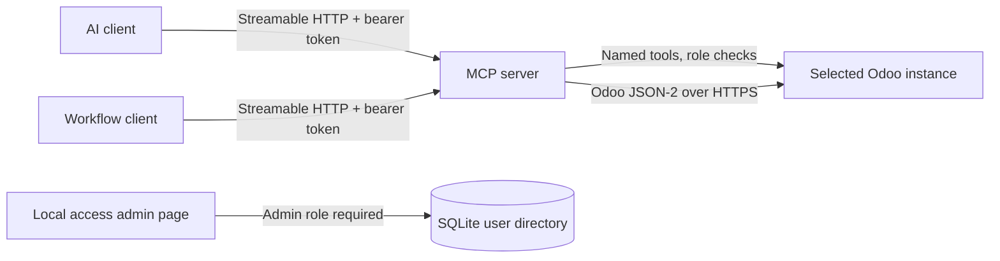

# Odoo Projects MCP

An independently deployable MCP server that gives AI clients and workflow tools a narrow, role-controlled interface to Odoo projects, tasks, website pages, and blog posts.

> **Portfolio project:** demonstrates integration planning, API discovery, scoped tool design, role-based access, Docker deployment, and security trade-off documentation. It is a prototype and has not been independently audited or certified for regulatory compliance.

## The problem

Business teams want to use AI assistants and automation with the project and website data already held in Odoo. Giving an AI client generic database or model access would be too broad. This service exposes named operations with explicit inputs and field allowlists, while Odoo's own permissions remain in force.

## Architecture



The operator selects a configured Odoo instance on each tool call. The server does not expose arbitrary SQL or a generic model-call tool. Odoo API credentials stay on the server.

## Current capabilities

- Search and read projects and tasks.
- Create and update projects and tasks with validated fields, including task assignees; move tasks between project stages and allowed states; archive and restore tasks and projects.
- Search and read website pages, update page content, and publish or unpublish with separate tools.
- List websites and blogs; search, read, create, and edit blog posts with explicit website targeting. Editors can write active-language translations and attach public cover images. Blog creation always starts unpublished, and publish/unpublish use separate tools and roles.
- Authenticate MCP users with bearer tokens and grant permissions through named roles.
- Manage Odoo connections, users, roles, token rotation, and revocation in a local admin page.
- Connect to Odoo 19 through its JSON-2 API over HTTPS.

## Security model and current limits

- MCP roles restrict tool access and each user can be restricted to named Odoo instances; Odoo permissions and record rules provide a second authorization layer.
- The Odoo instance name is selected explicitly, and the configured URL must use HTTPS.
- The default Compose binding is `127.0.0.1`; this is a local development setup, not a public deployment recipe.
- Existing SQLite users keep all-instance access during schema migration to preserve current behavior. A `*` scope also grants access to instances added later; review and narrow user scopes as needed.
- The admin page can add, edit, test, deactivate, and reactivate Odoo targets. API keys are kept in `mcp-state/odoo-instances.json` outside the source tree with restrictive file permissions; they are not encrypted by the application.
- Tokens are static bearer tokens. There is no OAuth/OIDC flow, rate limiting, or production audit trail yet.
- The same configured Odoo technical account is used for calls to a target, so Odoo does not attribute each MCP action to a distinct human user.
- The admin page is intended for local use. Remote use requires a deliberate identity, HTTPS, session, and deployment security design.
- No GDPR, AI Act, NIS2, or other compliance certification or conclusion is claimed. Applicability and controls depend on the deployment, data, purpose, and parties involved.

See [Architecture](docs/ARCHITECTURE.md), [Threat model](docs/THREAT_MODEL.md), and [Data protection notes](docs/DATA_PROTECTION.md) for assumptions and open work.

## Run locally

Requirements: Docker Compose and an Odoo instance with an enabled external API.

1. Set up Compose configuration and a private connection directory. For the local default:

   ```sh
   cp compose.env.example .env
   mkdir -p local
   cp .env.example local/.env
   cp odoo-instances.example.json local/odoo-instances.json
   cp mcp-users.example.json local/mcp-users.json
   ```

2. Set an Odoo API key and unique random MCP tokens of at least 32 characters in `local/.env`. Set the initial URL and API-key environment variable name in `local/odoo-instances.json`. In `local/mcp-users.json`, grant each user only the configured instance names they need; `*` means all current and future instances.
3. Start the service:

   ```sh
   docker compose up -d --build
   ```

The MCP endpoint is `http://127.0.0.1:8000/mcp`; the local admin page is `http://127.0.0.1:8000/admin`. The configured `owner` token is used to sign in. User tokens are shown once when created or rotated. Add later Odoo targets from the **Odoo instances** section; a successful authenticated read is required before creating or editing a connection, and the server repeats the check so a direct API request cannot bypass it. Removing a key is allowed only after deactivating that instance; an instance without a key cannot be reactivated. Local config, instance credentials, SQLite state, and `.env` files are outside Git and the Docker build context.

Choose **JSON-2** for Odoo 19+ or **XML-RPC** for Odoo 18 connections in the admin page. XML-RPC needs the database name, Odoo username/login, and an API key (used as the API password); JSON-2 uses an API key and an optional database name. Odoo 18's external API availability depends on the Odoo subscription plan.

When upgrading an existing SQLite user database, the schema adds the instance allowlist while preserving existing access as `*`. After starting the upgraded service, use the admin page to replace `*` with explicit instance names for each account before configuring additional Odoo targets.

To keep configuration outside the repository, set `MCP_CONNECTIONS_DIR` in the ignored project-root `.env` to the private configuration directory. Keep the API key and initial user tokens in that private directory's `.env`. On first startup, the service copies the bootstrap instance settings into `mcp-state/odoo-instances.json`; later API key changes are made in the admin page. Restrict access to this directory and back it up securely. The Compose file defaults to `./local` for a fresh clone.

## Roles

| Role | Tools |
| --- | --- |
| `viewer` | Connection check and project, task, and page search/read; archived records can be included in searches |
| `task_editor` | Create and update tasks; list project stages and change task stage/state |
| `task_archiver` | Archive and restore tasks |
| `project_manager` | Search, read, create, update, archive, and restore projects; list task stages |
| `website_editor` | Edit page content |
| `publisher` | Publish and unpublish pages |
| `blog_editor` | List websites and blogs; search, read, create, and edit blog posts |
| `blog_publisher` | List websites and blogs; search, read, publish, and unpublish blog posts |
| `blog_scheduler` | Reserved role for future-date blog scheduling; the scheduling tool is pending staging verification |
| `administrator` | All currently registered tools and user administration |

Roles can be combined for a user. Instance access is configured separately per user. New users in the admin page must receive explicit active instance names; use `*` only when they need every current and future instance.

Archiving a project also archives all its tasks. Restoring the project restores all its tasks too, including tasks that were already archived individually before the project was archived.

## Development

Run the unit suite in Docker:

```sh
docker build -f Dockerfile.test -t odoo-projects-mcp-test .
docker run --rm odoo-projects-mcp-test
```

An opt-in, read-only version probe is available by setting `ODOO_TEST_BASE_URL` for the test container. It checks `/web/version`; it does not validate authenticated reads, writes, or tenant isolation. These are documented validation gaps.

## Project status

The prototype has been exercised against an Odoo 19 Community test instance. The authenticated Odoo operations, multi-instance isolation, remote identity, audit retention, and production deployment controls still need a repeatable verification plan before production use.

The project plan and decisions are in [claude.md](claude.md). The next engineering priorities are repeatable authorization checks, security/audit controls, and automated CI checks.

## License

This project is licensed under LGPL-3.0. The license was chosen to align with Odoo Community's license; this connector is a separate project and does not contain Odoo source code. See [LICENSE](LICENSE).
