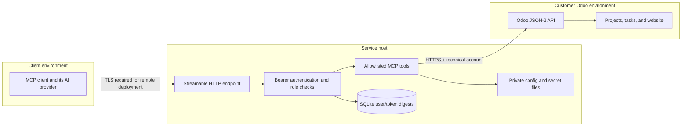

# Architecture and data flow

## Components

1. **MCP client:** an AI application or workflow runner sends a named tool request over Streamable HTTP and authenticates with its own bearer token.
2. **MCP service:** validates the token, maps it to roles, checks tool authorization, validates inputs, and selects an explicitly named Odoo target.
3. **Odoo connector:** sends a fixed model/method call to the configured JSON-2 endpoint (Odoo 19+) or XML-RPC endpoint (Odoo 18) over HTTPS, using a server-side API key.
4. **Odoo:** applies its own access rights and record rules. This is the final data authorization layer.
5. **Access administration:** a local web page manages users and roles in SQLite and Odoo connections in a private JSON store. It is intended for local administration only.

## Trust boundaries

The service receives and returns Odoo business data. If a client forwards tool results to a hosted AI provider, that provider becomes part of the deployment's data flow and must be assessed separately.

## Tool contract

Tools are specific to projects, tasks, website pages, and blog posts. Each tool owns its model, method, fields, input validation, and role requirement. There is no caller-supplied model/method pair, arbitrary SQL, or arbitrary Odoo domain in the public tool interface. Page and blog publication and unpublication are separate tools with separate permissions. Blog operations require an explicit website ID and scope reads and mutations to that website. Blog translations write with an explicit `lang` context, and only languages enabled on that website are accepted. Cover uploads are limited to public PNG, JPEG, or WebP attachments up to 5 MB and preserve existing cover properties. `blog_scheduler` can schedule publication at least ten minutes in the future. Until that date, Odoo hides a post only from the blog list; its URL, `/feed`, and `/sitemap.xml` already show it. Scheduling also sends Odoo's new-post notification to blog followers immediately.

The Odoo connector reads the connection user's context with `res.users.context_get` on the first model call and uses its `lang` as the default context for all calls in both protocols; explicit `context.lang` takes precedence. JSON-2 does not automatically use the user's language when the `context` argument is omitted: its API context is optional and defaults to an empty context, so it needs this same explicit language handling as XML-RPC. See [Odoo's JSON-2 API reference](https://www.odoo.com/documentation/19.0/developer/reference/external_api.html).

HTML blog content uses Odoo's term-level translation methods. Read the primary-language terms with `get_blog_post_translation_terms`, then pass only existing source terms and their translations as `content_terms` to `set_blog_post_translation`; other translatable fields are still written with the explicit language context.

Blog tools also accept the content generator's marked text (`content_format="marked_text"` on create/update, `content_marked_text` on `set_blog_post_translation`). `odoo_mcp/marked_text.py` is a pure conversion module: `H1:` becomes the name unless one is passed, `H2:`–`H6:` headings, `•`/`-`/`*` and numbered lines lists, other blocks paragraphs, and bare URLs links, after cleaning the Google Docs export and escaping `&`, `<` and `>`. It never adds or removes content, so selection and editorial decisions stay in the client. For translations, the module pairs translated blocks with the primary-language terms by position and validates block count and type before any write; mismatches return an error and nothing is written. An optional `lang` on `create_blog_post` and `update_blog_post` is validated against the website's primary language before any write and is then used as the write context, so the primary content never lands in another language.

## Configuration

- `odoo-instances.json` is the read-only bootstrap file. On first startup, its HTTPS URL, optional database, and resolved API key are copied to `mcp-state/odoo-instances.json` outside the repository. The private store is written with mode `0600`; subsequent changes use the admin page.
- `mcp-users.json` bootstraps the initial MCP identities, tool roles, and allowed instance names. `*` grants all current and future instances.
- Environment variables hold initial tokens and Odoo API keys used during bootstrap. Once the private instance store exists, API key changes must be made through the administration page.
- SQLite holds active/revoked user records and token digests after initial bootstrap.
- The admin page can add, edit, test, deactivate, and reactivate instances. Creating or editing requires a successful minimal authenticated read; the server repeats that check during create/update requests. Removing a key requires deactivation, and keyless instances cannot be reactivated. The API key is never returned to the browser after saving.
- Docker Compose defaults to an ignored `./local` directory. Operators may set `MCP_CONNECTIONS_DIR` in their ignored Compose `.env` to keep configuration outside the repository.

## Known design constraints

- Each MCP user has an instance allowlist, enforced on every tool call. The administrator role and admin page are still global to this service; this is a single-operator design, not tenant-separated administration.
- Existing SQLite users migrate with their previous all-instance behavior for compatibility. A wildcard user also receives access to instances added later; the admin page warns about this and operators should narrow scopes as needed.
- Odoo API keys in the persistent instance store are plaintext protected by filesystem permissions, not application-level encryption. Restrict access to the host data directory and include it only in encrypted, access-controlled backups.
- A shared technical Odoo identity means Odoo's audit trail does not identify each MCP user.
- The current web administration and static bearer token design is for local use. Remote access requires a separate identity and session design.
- Audit events, retention, backup, and recovery behavior need to be designed and implemented before production deployment.
