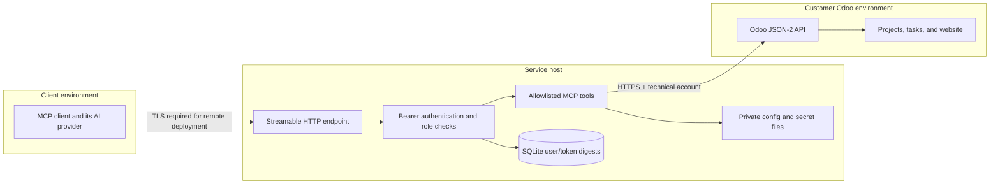

# Architecture and data flow

## Components

1. **MCP client:** an AI application or workflow runner sends a named tool request over Streamable HTTP and authenticates with its own bearer token.
2. **MCP service:** validates the token, maps it to roles, checks tool authorization, validates inputs, and selects an explicitly named Odoo target.
3. **Odoo connector:** sends a fixed model/method call to the configured JSON-2 endpoint over HTTPS, using a server-side API key.
4. **Odoo:** applies its own access rights and record rules. This is the final data authorization layer.
5. **Access administration:** a local web page manages users and roles in SQLite. It is intended for local administration only.

## Trust boundaries

The service receives and returns Odoo business data. If a client forwards tool results to a hosted AI provider, that provider becomes part of the deployment's data flow and must be assessed separately.

## Tool contract

Tools are specific to projects, tasks, and website pages. Each tool owns its model, method, fields, input validation, and role requirement. There is no caller-supplied model/method pair, arbitrary SQL, or arbitrary Odoo domain in the public tool interface. Page publication and unpublication are distinct tools.

## Configuration

- `odoo-instances.json` maps an operator-defined instance name to an HTTPS base URL, optional database, and the name of the environment variable holding its API key.
- `mcp-users.json` bootstraps the initial MCP identities, tool roles, and allowed instance names. `*` grants all configured instances.
- Environment variables hold initial tokens and Odoo API keys.
- SQLite holds active/revoked user records and token digests after initial bootstrap.
- Docker Compose defaults to an ignored `./local` directory. Operators may set `MCP_CONNECTIONS_DIR` in their ignored Compose `.env` to keep configuration outside the repository.

## Known design constraints

- Each MCP user has an instance allowlist, enforced on every tool call. The administrator role and admin page are still global to this service; this is a single-operator design, not tenant-separated administration.
- Existing SQLite users migrate with their previous all-instance behavior for compatibility; operators should review and narrow each account in the admin page before adding more Odoo targets.
- A shared technical Odoo identity means Odoo's audit trail does not identify each MCP user.
- The current web administration and static bearer token design is for local use. Remote access requires a separate identity and session design.
- Audit events, retention, backup, and recovery behavior need to be designed and implemented before production deployment.
